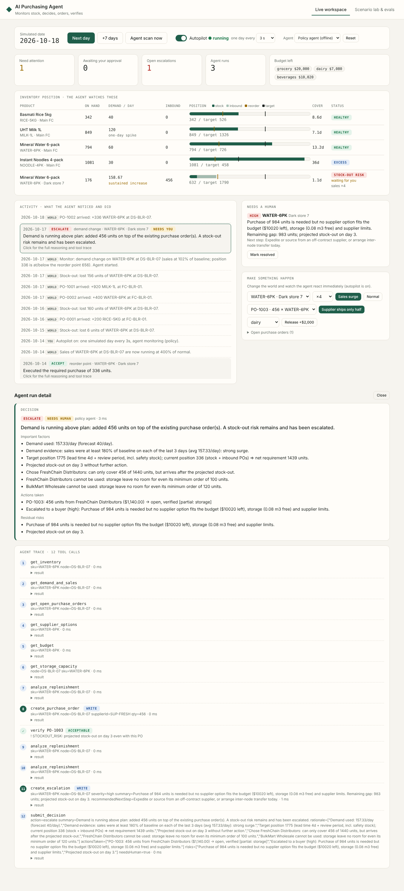
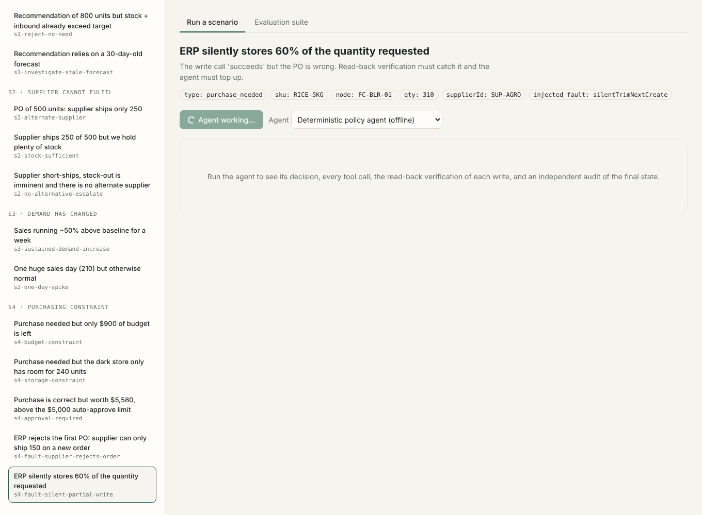
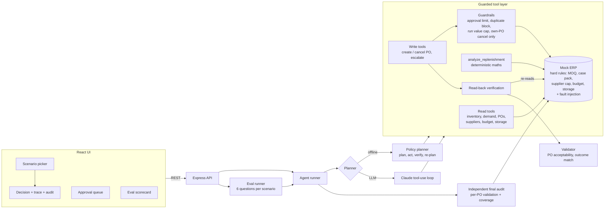
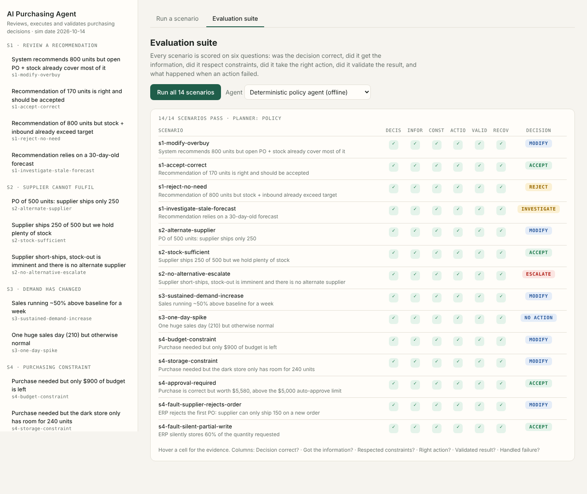

# AI Purchasing Agent

A full-stack agent that takes a purchasing situation, **investigates** it with tools, **decides** (accept / modify / reject / investigate / escalate), **acts** in a mock purchasing system, and then **validates the outcome** and recovers when reality differs from what it expected.

It is not a chatbot that answers purchasing questions. It makes, executes and verifies purchasing decisions, and it can be graded on them.

| | |
|---|---|
| Scenarios | **All four** from the brief (review a recommendation, supplier short-ships, demand changed, purchasing constraint), as 14 concrete test cases |
| Feedback loop | Every write is **read back from the ERP** and independently validated; the agent **re-plans from the state the ERP actually holds** |
| Human in the loop | POs above a value limit are queued for approval and cannot be committed by the agent |
| Agents | A deterministic **policy agent** (runs offline, used for CI/evals) and a **Claude tool-use agent**, both going through the same guarded tool layer |
| Evaluation | 14 scenarios x 6 questions from the brief, plus a naive "blindly execute" agent that the evals must fail |



**The app has two parts:**

1. **Live workspace (the running application).** A simulated warehouse evolves day by day (sales consume stock, POs arrive on their ETA). The agent **monitors it continuously**, notices problems by itself (stock at its reorder point, a supplier short-shipping, a sales surge), investigates, acts, verifies, and hands off to a human when it must. Turn on *Autopilot* and watch it work, or step the days yourself.
2. **Scenario lab & evals.** The 14 fixed scenarios from the brief, with full trace and a scorecard.



## Quick start

Requires Node 22+.

```bash
npm install
cp .env.example .env        # optional: defaults work with no API key
npm run dev                 # API on :8787, UI on http://localhost:5173
```

Or as a single process / container (UI is served by the API):

```bash
npm run build && npm start              # http://localhost:8787
docker compose up --build               # same, in Docker
```

> The Dockerfile mirrors the verified non-Docker path (production-only install + built bundle serving the UI and API), but I could not run a Docker daemon where this was built, so the image itself has not been built. If `docker compose up` fails, `npm run build && npm start` is the same thing.

Other commands:

```bash
npm test             # 41 unit / integration tests
npm run eval         # the evaluation suite, prints a scorecard (exit code 1 on any failure)
npm run eval -- --verbose --only s4-fault-silent-partial-write
npm run typecheck
```

### Using the Claude agent

The default `LLM_PROVIDER=policy` needs no key. To let Claude drive the same tools, set in `.env`:

```
LLM_PROVIDER=anthropic
ANTHROPIC_API_KEY=...
ANTHROPIC_MODEL=claude-sonnet-5-5
```

You can also pick the agent per run in the UI, or run `npm run eval -- --provider anthropic` to grade the LLM with the same suite.

> **Honest status:** the Claude agent's tool-use loop is covered by tests using a scripted fake client (loop mechanics, guardrails, "model never submits a decision"), but it has **not been run against the live API in this repository's CI**. Run `npm run eval -- --provider anthropic` once with your key to see how it scores; the guardrails and the independent audit apply to it exactly as to the policy agent.

## The live workspace

`server/src/workspace/workspace.ts` wraps the agent in an application:

- **World:** a mock ERP seeded with 5 SKU x node pairs in different states (healthy, needs an order, excess, tight storage). `advanceDay()` receives POs whose ETA arrived, then takes the day's sales (seeded RNG, deterministic); the planning forecast refreshes weekly like a real planner.
- **Monitor:** after each day (or on demand) it scans every pair and raises an issue when
  - a PO's supplier confirmed less than ordered (`supplier_shortfall`, once per PO),
  - inventory position has fallen to the **reorder point** and demand evidence shows a sustained increase (`demand_change`), or
  - position is at the reorder point (`purchase_needed`, ordered up to target).
  Each issue is handed to the **same agent** used by the scenarios. After every run it re-detects, because the agent's own actions change budget, storage and positions.
- **Human in the loop:** POs above the limit wait in the approval queue (the position counts them, so the agent never double-orders). A pair with an **open escalation is parked** until a human marks it resolved, so the agent does not nag about something only a human can fix (e.g. release budget).
- **Controls (UI):** next day / +7 days / scan now, Autopilot (one simulated day every 1.5-6 s on the server), and a "make something happen" panel: sales surge, supplier ships only half, release budget. With Autopilot on the agent reacts to an event immediately.
- **Why a reorder point:** an earlier version ordered whenever position was below target and spammed tiny MOQ-sized orders almost daily (37 runs in 21 simulated days vs 11 now). Classic (s,S): act at the reorder point, order up to target.

## Architecture



### Layout

```
server/src/
  domain/       pure logic: types, replenishment maths, situation model, validator
  erp/          mock ERP (in-memory) with hard business rules, approvals, fault injection; seed data
  tools/        the agent's only interface to the world; guardrails + verification live here
  agent/        policy planner, Claude planner, runner (+ final audit)
  scenarios/    14 scenarios: seed data, trigger, injected fault, expectations
  eval/         scoring on the six questions, CLI
  api/          Express API
web/            React UI (Vite)
server/test/    unit, guardrail, LLM-loop, API and eval tests
```

## Approach

### What information matters
For a SKU at a node: on-hand stock, demand (forecast **and** 14 days of actual sales), open POs (using the **supplier-confirmed** quantity, not the ordered quantity), supplier terms (cost, lead time, MOQ, case pack, per-order cap, reliability, active), remaining category budget, and free storage volume (capacity minus stock minus space reserved by inbound POs).

### How decisions are made
`analyze_replenishment` is the single source of numerical truth (the LLM is told not to do arithmetic):

- **Horizon** = supplier lead time + review period. **Target position** = demand x horizon + safety stock (`z * sigma * sqrt(horizon)`).
- **Inventory position** = on hand + inbound. **Net requirement** = `max(0, target - position)`, rounded up to case pack and MOQ.
- Per supplier: the largest legal quantity that fits **budget, storage and the supplier cap**, and whether it would arrive before the projected **stock-out day**.
- **Demand evidence**: a *sustained* increase (median of last 7 days >= 130% of baseline, on >= 5 of 7 days) raises the plan; a **one-day spike** does not; a **stale forecast** (> 14 days) blocks acting on it.

Supplier choice ranks: arrives before stock-out, then covers the full requirement, then the recommended/primary supplier, then (if partial) the larger quantity, then cost adjusted for reliability.

### What the agent may do
Read anything; create POs; cancel **only POs it created**; open escalation tickets. It cannot edit buyer/system POs, cannot commit a PO above the auto-approve limit (those go to the approval queue), cannot place an identical order twice in one run, and cannot commit more than 10x the approval limit per run.

### Mapping to the four scenarios

| Scenario | What the agent does |
|---|---|
| **1. Review a recommendation** (800 units) | Computes the real requirement from stock + inbound POs + demand. *Accept* if the recommendation matches (within 10%), *modify* to the right quantity, *reject* if the position already exceeds target, *investigate* (ticket, no action) if the forecast is stale. |
| **2. Supplier cannot fulfil** (500 -> 250) | Re-computes position with the confirmed 250. If stock still covers the target: accept the short shipment. Otherwise sources the gap from the best alternate supplier. If nothing can arrive in time: partial mitigation + **high-severity escalation**. |
| **3. Demand changed** | Separates a sustained trend from a one-day spike, re-plans against effective demand, and tops up the PO only when the evidence supports it. |
| **4. Constraint blocks the purchase** | Budget, storage, supplier cap or approval limit. Buys what fits, explains why alternatives are blocked (e.g. cheaper supplier's MOQ exceeds the budget), escalates the remainder, or queues for approval. |

## The feedback loop (validation)

The brief asks specifically how we know the resulting PO is acceptable and what happens when the outcome differs from the expectation. There are three independent layers:

1. **Write -> read-back -> validate (every write).** After `create_purchase_order`, the tool re-reads the PO from the ERP and runs `verifyOutcome` (did the ERP store the supplier/qty we asked for?) and `validatePo` (MOQ, case pack, supplier cap, supplier active, budget not overdrawn, storage not overbooked, approval limit not bypassed, ETA/price consistent; warnings for excess stock and remaining stock-out risk). The agent never trusts the write call's return value.
2. **Closed-loop re-planning.** After each write the planner re-runs `analyze_replenishment` against the *stored* state and plans again, until the position is covered or nothing feasible is left (then it escalates). This one mechanism handles:
   - **ERP rejects the order** (`SUPPLIER_CAPACITY`, max 150): the cap is learned, the agent re-plans with it, orders what fits and covers the rest from another supplier.
   - **ERP silently stores 60% of the quantity**: verification flags `QTY_MISMATCH`; the re-plan sees the remaining gap and tops it up.
   - **A PO fails validation for another reason**: it is cancelled and the supplier excluded.
   - **No progress / step budget exhausted**: escalates to a human instead of looping.
3. **Independent final audit** (in the runner, not in the agent): re-validates every PO the agent created and recomputes coverage from the final ERP state. The run is marked `needs_human` if anything is invalid, and `failed` if the agent crashed or never submitted a decision.

## Evaluation

`npm run eval` (or the *Evaluation suite* tab) runs 14 scenarios. Each is scored on the six questions from the brief:

| Question | How it is checked |
|---|---|
| Was the decision correct? | Final decision is in the hand-written set of acceptable decisions for that scenario |
| Did it obtain the necessary information? | The trace must contain the required read tools (e.g. the PO and demand evidence) |
| Did it respect the constraints? | The **audit's** validation of every created PO has no violations (budget, storage, MOQ, case pack, supplier cap, approval limit) |
| Did it take the appropriate action? | Number of POs in range, human hand-off present/absent as expected, scenario-specific checks (e.g. supplier, quantity range, status `pending_approval`) |
| Did it validate the result? | Each successful write has a verification event; state was re-analysed; final coverage restored when a human isn't required |
| What happens when the initial action fails? | For fault scenarios: a failed write or verification mismatch was observed, **and** coverage was restored. For clean scenarios: no failed writes |

Expectations are **hand-written per scenario**, not derived from the agent's own maths, and the constraint/validation checks read the final ERP state rather than the agent's claims.

| Group | Scenarios |
|---|---|
| S1 | `s1-modify-overbuy`, `s1-accept-correct`, `s1-reject-no-need`, `s1-investigate-stale-forecast` |
| S2 | `s2-alternate-supplier`, `s2-stock-sufficient`, `s2-no-alternative-escalate` |
| S3 | `s3-sustained-demand-increase`, `s3-one-day-spike` |
| S4 | `s4-budget-constraint`, `s4-storage-constraint`, `s4-approval-required`, `s4-fault-supplier-rejects-order`, `s4-fault-silent-partial-write` |

**Can the evals fail?** Yes, and a test proves it: `server/test/naivePlanner.ts` is a bot that blindly executes whatever it is told. `evals.test.ts` asserts it fails the over-buy, no-need, stale-forecast, budget, storage and both fault scenarios (and at least 8 of 14 overall).



## Mock data and APIs

Everything needed to run is in the repo: `server/src/erp/seed.ts` (products, suppliers, terms, budgets, storage for two nodes) and `server/src/scenarios/index.ts` (per-scenario inventory, sales history, POs, injected faults). The "ERP" is an in-memory class (`MockErp`) exposed to the agent only through the tool layer; the HTTP API exposes `GET /api/scenarios`, `POST /api/runs`, `GET /api/runs/:id`, `POST /api/runs/:id/approvals/:approvalId`, `POST /api/evals`, `GET /api/health`. Time is fixed (`SIM_DATE`) so runs are deterministic.

## Configuration

See `.env.example`. Business rules that change decisions: `AUTO_APPROVE_LIMIT_USD`, `REVIEW_PERIOD_DAYS`, `SERVICE_LEVEL_Z`, `EXCESS_COVER_FACTOR`. No secrets are committed; `.env` is git-ignored.

## Known limitations and what I would do next

- **Mock ERP is in-memory and single-process.** A real integration needs persistence, idempotency keys on PO creation and optimistic concurrency; the tool layer is where those would go.
- **Single-supplier orders.** The agent picks one supplier per order and re-plans, so it can place a second order with another supplier, but it does not optimise splits across suppliers.
- **Trend detection has a lag.** A sustained increase needs ~5 elevated days, or 3 consecutive days at >= 1.8x baseline (fast path for big surges). A modest surge can therefore cause some lost sales before the agent reacts; that is the price of not chasing one-day spikes. The live workspace shows these as "Stock-out: lost N units" in the activity feed.
- **Demand model is simple** (baseline, median-vs-baseline trend test, normal safety stock). Promotions, seasonality and forecast-error learning are flagged in evidence notes but not modelled.
- **Approval is a single threshold.** A real policy would vary by category, supplier and role.
- **LLM agent unproven live** (see above). Next step: record a live run's trace and add an LLM-as-judge on rationale quality, with the deterministic checks remaining the gate.
- **Optional extensions** from the brief that the same architecture supports with new tools/scenarios: supplier reliability weighting (already in ranking), promo buying, open-PO review, forecast anomaly detection.
